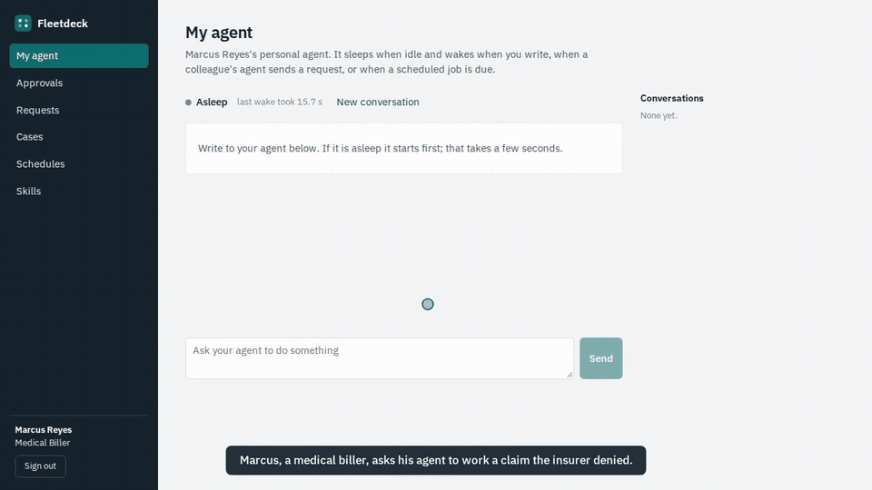
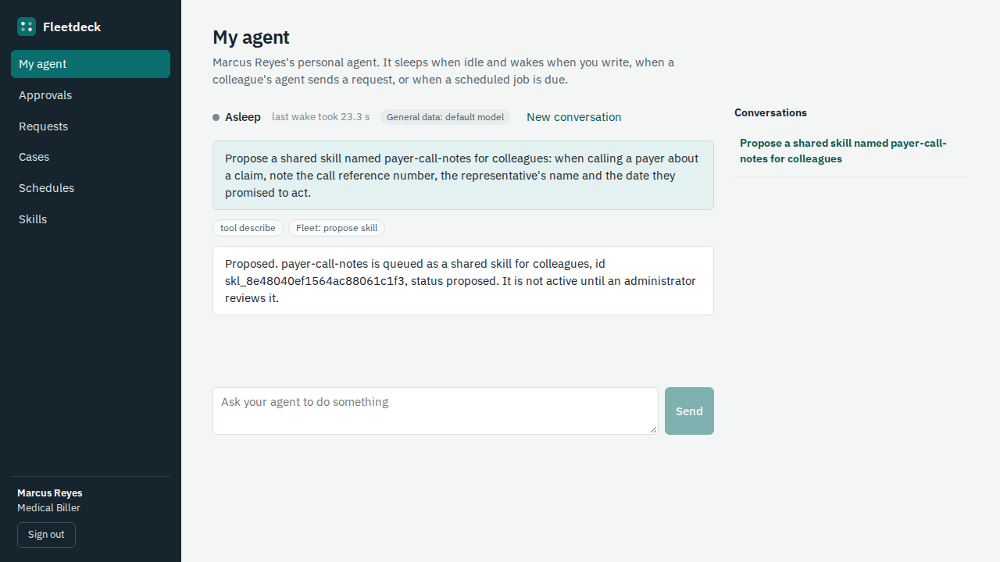
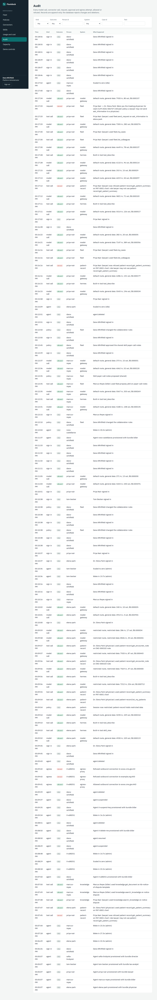
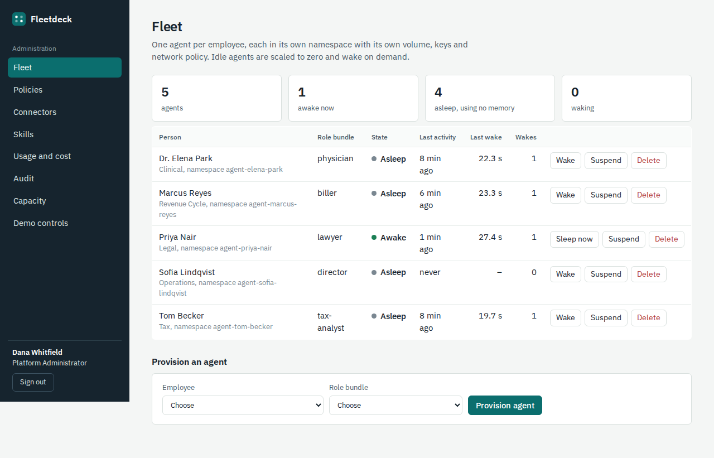
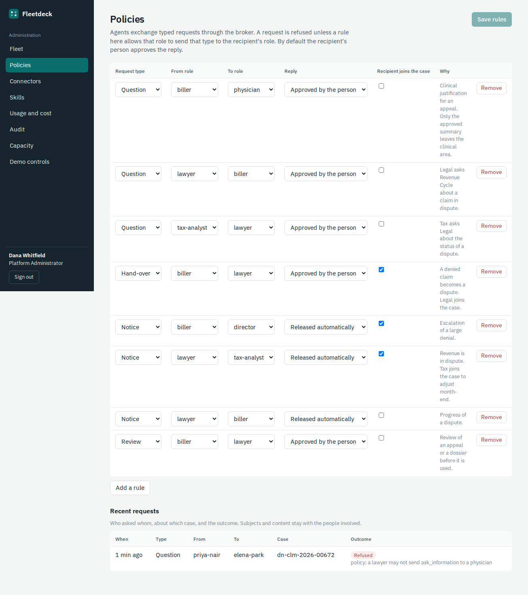
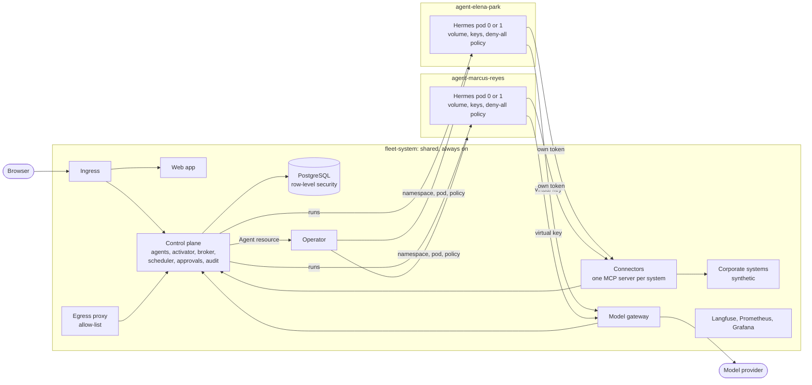

# Fleetdeck

A platform that gives every employee their own AI agent on Kubernetes: isolated by the
infrastructure, asleep when idle, and able to work with colleagues' agents and the company's
systems through shared, access-controlled services.




## What it does

- **One agent per employee, kept apart by the cluster.** Each agent runs in its own namespace
  with its own volume, keys and default-deny network policy. Nothing relies on a prompt to keep
  two people's data apart, and every boundary has a test that tries to cross it.
- **The bill follows active users, not headcount.** An idle agent is scaled to zero and wakes
  when its person writes, when a colleague's agent sends a request, or when a scheduled job is
  due. Its conversations and memory stay on its volume.
- **Agents work together without talking freely.** They exchange typed requests through a
  broker. A policy decides who may ask whom for what, the request text reaches the other agent as
  data, and the reply leaves only after its human owner approves it.
- **Access is decided where the data lives.** Connectors act as the calling person, with that
  person's role and case membership. Case documents are filtered by PostgreSQL row-level security.
  Sensitive data changes which model a conversation may use.
- **Everything is on the record.** Every model call, connector call, request, approval and
  refused attempt is in an append-only audit trail, traced in Langfuse and counted in Grafana,
  with cost attributed to the person.

The demo company is **Meridian Health Group**, a fictional clinic network. Its storyline is an
insurer denial that becomes a dispute, worked by five people's agents across billing, the clinic,
legal, tax and management. All people, patients, companies and documents are synthetic.

## Quick start

You need Docker, `kubectl`, [`k3d`](https://k3d.io), [`helm`](https://helm.sh), `make`,
[`uv`](https://docs.astral.sh/uv/) and an [OpenRouter](https://openrouter.ai) API key.

```bash
git clone https://github.com/joaopaulopresa/fleetdeck.git && cd fleetdeck
cp .env.example .env          # then put your key in OPENROUTER_API_KEY
make up                       # cluster, images, platform, demo company and its five agents
```

Open <http://localhost:8090> and pick a person on the sign-in screen (the demo has built-in
users and no passwords). Sign in as **Marcus Reyes** and write:
`Work the denied claim CLM-2026-01187.` Then sign in as **Dr. Elena Park** and look at
Approvals. **Dana Whitfield** is the platform administrator.

| What | Where |
|---|---|
| Application | <http://localhost:8090> |
| Langfuse (traces) | <http://langfuse.localhost:8090>, `admin@meridian-health.example` / `fleetdeck-demo` |
| Grafana (dashboards) | <http://grafana.localhost:8090> |

A clean `make up` took 8 min 30 s here with the images already downloaded. The first one also downloads about 6 GB of images, most of it the Hermes Agent image and the
Langfuse stack. `make down` deletes the cluster.

## Demos

Recorded by Playwright scripts in `e2e/demo/` that drive the real application on a local cluster;
every agent answer is a real model run. Stretches where an agent is working are sped up, and the
caption on screen says so.

| | |
|---|---|
| [](docs/media/video-1-storyline.mp4) | **The storyline.** A denied claim goes from billing to the physician, back to an appeal, on to legal and tax, and ends with the director's question answered from the systems. |
| [](docs/media/video-2-isolation.mp4) | **Isolation and audit.** The lawyer's agent is refused the patient record; the refusal is in the audit search and on the security dashboard. |
| [](docs/media/video-3-scale-to-zero.mp4) | **Scale to zero.** Agents asleep, one wakes on a message and sleeps again; the capacity view. |
| [](docs/media/video-4-admin.mp4) | **Administration.** Provision a new employee's agent, change a policy, review a skill an agent proposed. |

## Architecture



- **Control plane** (FastAPI, PostgreSQL). Provisions agents, wakes them on demand (the
  activator), puts idle ones to sleep, runs their work, brokers requests between them, holds
  approvals, schedules recurring jobs and writes the audit trail. It can write `Agent` resources
  and the agents' keys and nothing else in the cluster.
- **Operator** (kopf). Turns each `Agent` resource into a namespace with a non-root Hermes pod,
  a volume, a service account without API credentials and a default-deny network policy, all
  rendered from one template. It scales the pod between 0 and 1.
- **Model gateway.** The only path to a model. An agent presents a virtual key; the gateway
  resolves who it is and what it is working on, chooses the route from the conversation's data
  class, forwards with the real provider key, and reports usage and cost. Agents never hold the
  provider key and cannot choose the model.
- **Connectors.** One MCP server per corporate system, plus the knowledge base and the request
  tools. Each call carries the agent's own token; the control plane checks the role's permission
  for that tool and membership of the record's case, and audits the decision. Write tools only
  create drafts that the person confirms.
- **Agents.** [Hermes Agent](https://github.com/NousResearch/hermes-agent), one per employee,
  started from a role bundle: a brief, the connectors the role may reach, skills and schedules.
  Terminal, file, web and code-execution tools are switched off.

Three rules shape the rest. A conversation's **data class only rises**: once an agent reads a
patient chart, every later model call of that conversation uses the restricted route. There is
**no write-down**: content from a more sensitive conversation cannot be written into a less
sensitive case or sent as a request. And only **a person can release** such content, by approving
a reply, which is how the physician's summary reaches billing while the chart stays in the clinic.

## Tech stack

Python 3.13 (FastAPI, SQLAlchemy, Alembic, kopf, the MCP SDK), PostgreSQL 16, React 19 with
TypeScript and Vite, Kubernetes (k3s through k3d), Helm, Hermes Agent, OpenRouter, Langfuse,
Prometheus, Grafana, pytest, Playwright.

## Testing

```bash
make lint typecheck   # ruff, helm lint, mypy --strict
make test             # unit, API and connector tests: no cluster, no model key
make test-cluster     # the boundaries, tried from inside real agent pods
make test-live        # the same cluster, with real model calls (a fraction of a cent)
make test-e2e         # Playwright against the web app
```

- **Unit, API and connector tests** run against a real PostgreSQL in a container, the real
  control-plane application and the real synthetic systems, with a fake cluster and a fake agent.
  They cover the refusals as well as the happy paths: wrong role, non-member of a case, forged or
  suspended token, straight SQL as the row-level-security role, deciding someone else's approval,
  a request policy forbids, writing restricted content into a confidential case.
- **Cluster tests** run from inside real agent pods on k3d. An agent pod is refused by another
  agent's pod, the internet, the Kubernetes API, the node, the database and the control plane; it
  holds no Kubernetes credentials and no provider key; its namespace rejects a privileged pod;
  egress goes only to the allow-list; a suspended agent's key stops working; sleep removes the
  pod and wake restores its state.
- **Live tests** check that a real model call is attributed to the person and traced, and that a
  run which reads a patient chart moves to the restricted route.

## Project structure

```
control-plane/   FastAPI: agents, activator, runs, broker, approvals, scheduler, audit, console API
operator/        The Agent resource reconciler and the per-agent manifest template
model-gateway/   Virtual keys, routing by data class, usage and cost, traces
connectors/      One MCP server per system, the knowledge base and the request tools
mock-systems/    Patient record, billing, ERP, docket, contracts (synthetic)
egress-proxy/    Allow-list CONNECT proxy
common/          Settings, errors, tokens and the internal API client shared by the services
bundles/         Role bundles: brief, connectors, skills, schedules
seed/            The synthetic company, its generator and the storyline
web/             Employee page and administration console
deploy/          Helm chart, k3d cluster definition, Grafana dashboards
tests/cluster/   Tests that run against the k3d cluster
e2e/             Playwright tests and the demo recording scripts
```

## Measured on the development machine

One k3d node on a 16-core, 62 GB workstation that was busy with other work during the
measurements, Hermes Agent v0.23.1. Numbers are from this machine only.

| What | Measured | How |
|---|---|---|
| Wake, from asleep to answering its health check | 14.7 to 27.4 s, median 20.2 s (7 wakes of the demo agents) | wake durations recorded by the activator, on the Capacity page |
| Sleep, until the pod is gone | 2 to 6 s | `kubectl scale` then `kubectl wait --for=delete`, during the spike |
| Memory of one awake agent pod | 227 to 447 MiB working set, 298 MiB on average (4 pods) | `container_memory_working_set_bytes` in Prometheus, on the Capacity page |
| Memory of a sleeping agent | none (no pod); its volume held about 6 MB | `du` on the volume |
| Input tokens per model call | median 6,062 (4,913 to 8,506, 21 calls) with a role bundle; 23,600 with Hermes's defaults | usage reported by the provider, in the `model_calls` table |
| Clean install, `make up` from no cluster | 8 min 30 s, with every image already on the machine | `time make up` |
| Model cost of a fresh install's checks and two demo recordings | $0.012 for 27 calls | Usage and cost page |

## Limits and what was not tested

- **The restricted route is a stand-in.** Patient data in the demo goes to an open-weight model
  on OpenRouter, because all data is synthetic. Real patient data must not be sent to a public
  provider: set `models.restrictedUpstreamUrl` in the chart values to a model the company hosts.
- **Demo sign-on.** Built-in users without passwords. A real installation needs an identity
  provider; the session token is the seam for it.
- **One node, five agents.** Not tested: several nodes, more than a handful of agents awake at
  once, high availability of the control plane (it runs as one replica), upgrades of Hermes.
- **Wake time is tens of seconds**, dominated by Hermes's own start-up. The interface shows the
  agent waking; there is no warm pool.
- **Agents can be wrong.** Access, money, tax and deadlines do not depend on the model, and
  everything it writes is a draft, but the text of a draft is only as good as the model and
  needs the review the approvals page asks for.
- **Memory across data classes.** Hermes's own memory is one store per agent. The platform does
  not stop an agent from remembering something from a restricted conversation and recalling it
  in a later one.
- **Not built yet:** backups and restore, a shared pod for teams that trust each other, vector
  search in the knowledge base (it uses PostgreSQL full-text search), Slack or Teams adapters.
- **Not evaluated:** LiteLLM as the gateway, CrabTrap as the egress proxy, the community Hermes
  operators.

## Licence and credits

MIT, see [LICENSE](LICENSE).

- [Hermes Agent](https://github.com/NousResearch/hermes-agent) by Nous Research (MIT) is the
  agent runtime.
- The design follows the one-agent-per-employee deployment Razorpay has described publicly, and
  adds collaboration between agents, shared corporate resources and scale to zero.
- Models are served through [OpenRouter](https://openrouter.ai). The synthetic patients, notes
  and contract clauses were generated with `meta-llama/llama-3.1-8b-instruct`; see
  `seed/generate.py`.
